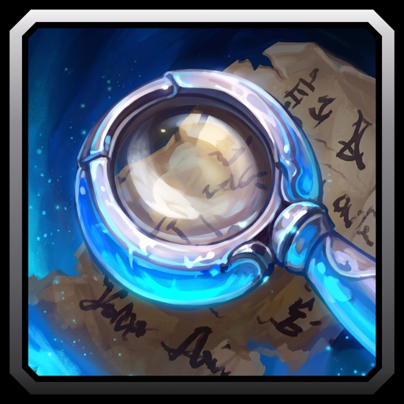

# Chat Scan

Never miss the trade or group you want: Chat Scan watches chat for your keywords and forwards every match to your chat tabs.

- **Set** keywords, such as `wts, thunderfury` or `lf, tank`
- **Pick** the channels to watch
- **Get** every match in the chat tabs you choose, with an optional sound

## Why use it

- **Stop reading every channel.** Only the lines you care about reach you.
- **Smart matching.** `lf` finds LFG but not "self", and a linked item matches by its name.
- **Looks native.** Forwarded lines look like the game's own, with clickable names and the time.

## Features

- Each keyword row is one rule. Commas need every word, so `lf, tank` needs both
- Keywords match the start of a word and ignore case
- Watches General, Trade, LookingForGroup, custom and community channels, plus guild, group, say, yell, emote and whisper
- A repeated line from the same sender shows once every 2 minutes
- Optional alert sound
- Your scan resumes after login
- A welcome line, a tip and tooltips show you around

## Quick start

1. Type `/cs` or click the minimap button. The first time, your joined channels are ticked for you
2. Under Keywords, type a rule and press Enter. The scan starts
3. Tick the channels and chat types to watch
4. Under Output Tabs, tick the tabs that get the matches
5. Under Sound, pick an alert or None
6. Press Stop or Start, or right-click the minimap button

## Commands

- `/cs <rule>` adds a rule and starts scanning
- `/cs start`, `/cs stop` and `/cs clear` start, stop and clear
- `/cs minimap` hides or shows the minimap button
- `/cs intro` shows the welcome line and the tip again
- `/cs help` lists the commands
