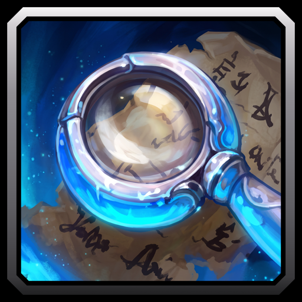

# Chat Scan

A WoW Forever addon that watches the chat you pick for your keywords and forwards every matching line to the chat tabs you choose. You catch the trades and groups you want without reading every channel.

## Features

- Each keyword row is one rule. Commas in a row need every word, so `lf, tank` needs both.
- Keywords match the start of a word and ignore case, so `lf` finds LFG but not "self".
- Watches General, Trade, LookingForGroup, custom and community channels, plus guild, group, say, yell, emote and whisper.
- Forwarded lines look like the game's own, with clickable names and the time.
- A repeated line from the same sender shows once every 2 minutes.
- An optional alert sound.
- Your scan resumes after login.
- A welcome line, a tip and tooltips show you around the first time.

## Usage

1. Type `/cs` or click the minimap button. The first time, your joined channels are ticked for you.
2. Under Keywords, type a rule such as `wts thunderfury` or `lf, tank` and press Enter. The scan starts.
3. Tick the channels and chat types to watch.
4. Under Output Tabs, tick the chat tabs that get the matches.
5. Under Sound, pick an alert or None.
6. Press Stop to pause and Start to resume, or right-click the minimap button.

Commands:

- `/cs <rule>` adds a rule and starts scanning.
- `/cs start`, `/cs stop` and `/cs clear` start, stop and clear.
- `/cs minimap` hides or shows the minimap button.
- `/cs intro` shows the welcome line and the tip again.
- `/cs help` lists the commands.
